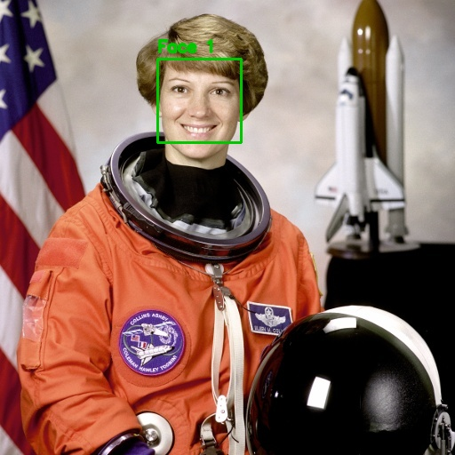
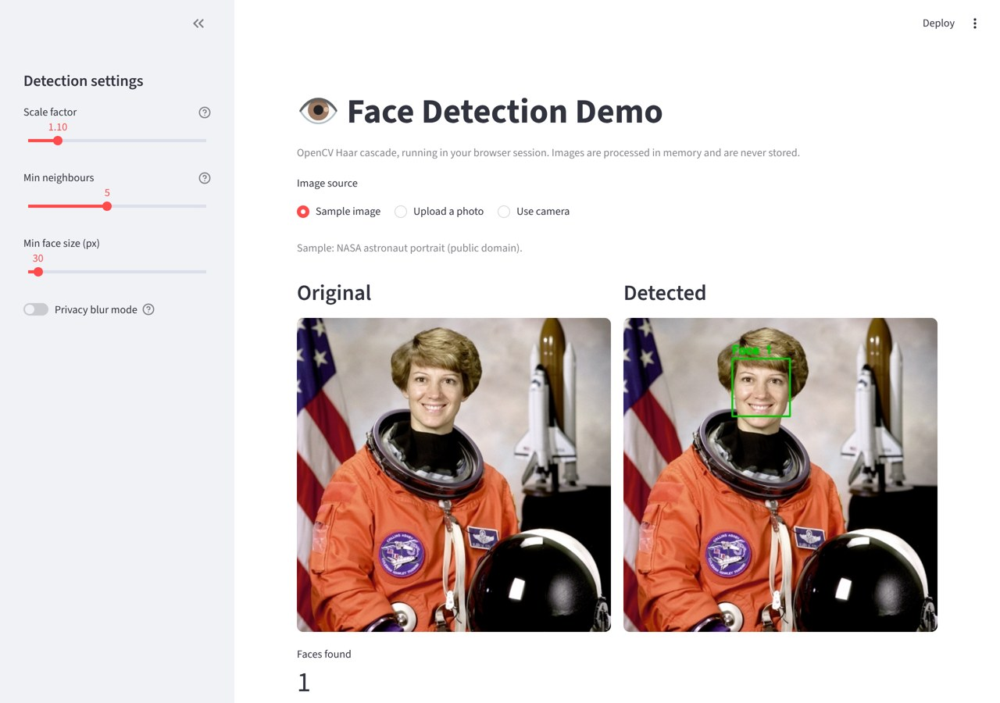

# Face Detection with OpenCV

A Python computer-vision project that detects human faces in **images, video files and a live webcam feed** using OpenCV's Haar cascade classifier. It includes a command-line interface, a privacy **blur mode**, and automated tests.

**[▶ Try the live demo](https://face-detection-opencv-demo.streamlit.app/)** – upload a photo or use your camera, no install needed.

| Boxes mode | Privacy blur mode |
|---|---|
|  |  |

*Sample photo: astronaut Eileen Collins, NASA (public domain).*

## Features

- **Image detection** – detect and count faces in a photo and save the annotated result.
- **Video detection** – process a video file frame by frame and report how many frames contain faces and the maximum faces seen at once.
- **Live webcam detection** – real-time detection with a face counter and FPS display.
  Keys: `q` quit · `s` save snapshot · `b` toggle blur.
- **Privacy blur mode** – blur every detected face instead of drawing boxes (`--blur`).
- **Tunable detection** – adjust scale factor, minimum neighbours and minimum face size from the command line.
- **Input validation and clear errors** – bad paths or unreadable files return a helpful message, not a crash.
- **Web demo** – Streamlit app with photo upload, camera input, adjustable settings and result download (`web/app.py`).
- **Automated tests** – 13 tests covering the detector, drawing/blur helpers, the CLI and the web app.

## Tech Stack

Python · OpenCV · NumPy

## Getting Started

```bash
git clone https://github.com/shifafaheem05-lgtm/face-detection-opencv.git
cd face-detection-opencv

python -m venv venv
venv\Scripts\activate          # Windows
# source venv/bin/activate     # macOS / Linux

pip install -r requirements.txt
```

## Usage

```bash
# 1. Image (try the included sample)
python -m face_detector image samples/astronaut.jpg

# 2. Blur faces instead of drawing boxes
python -m face_detector image samples/astronaut.jpg --blur

# 3. Video file
python -m face_detector video path/to/video.mp4

# 4. Live webcam
python -m face_detector webcam
```

Results are saved in the `output/` folder (or use `-o path` to choose).

### Options

| Option | Meaning | Default |
|---|---|---|
| `--scale` | Image pyramid scale factor (smaller = more accurate, slower) | 1.1 |
| `--neighbors` | Overlapping detections needed (higher = fewer false positives) | 5 |
| `--min-size` | Smallest face to detect, in pixels | 30 |
| `--blur` | Blur faces instead of drawing boxes | off |
| `-o, --output` | Output file path (image and video) | `output/` |
| `--camera` | Camera index (webcam mode) | 0 |

## Run the web demo locally

```bash
pip install -r web/requirements.txt
streamlit run web/app.py
```



## Run the tests

```bash
python -m unittest discover -s tests -t .
```

## Project Structure

```
face-detection-opencv/
├── face_detector/
│   ├── detector.py     # FaceDetector class: detect, draw, blur
│   ├── cli.py          # image / video / webcam commands
│   └── __main__.py     # enables: python -m face_detector
├── web/                # Streamlit demo (app.py, requirements.txt)
├── tests/              # unit tests
├── samples/            # sample image
├── assets/             # README screenshots
└── requirements.txt
```

## How It Works

1. The frame is converted to grayscale and its histogram is equalised to cope with uneven lighting.
2. OpenCV's pre-trained frontal-face Haar cascade scans the image at several scales (`detectMultiScale`).
3. Each detection is returned as a `Face(x, y, w, h)` bounding box, which is then drawn on or blurred out of a copy of the frame.

## Limitations

Haar cascades work best on well-lit, front-facing faces. They can miss side profiles, heavily rotated faces or faces in very low light, and may occasionally produce false detections in busy backgrounds.

## Future Improvements

Deep-learning detector (DNN or MediaPipe) for better accuracy, face recognition, attendance integration with my [Django Attendance Management System](https://github.com/shifafaheem05-lgtm/django-attendance-management-system), and a simple web interface.

## Author

**Shifa Faheem** – [GitHub](https://github.com/shifafaheem05-lgtm) · [LinkedIn](https://www.linkedin.com/in/shifa-faheem-dev)

Released under the [MIT License](LICENSE).
